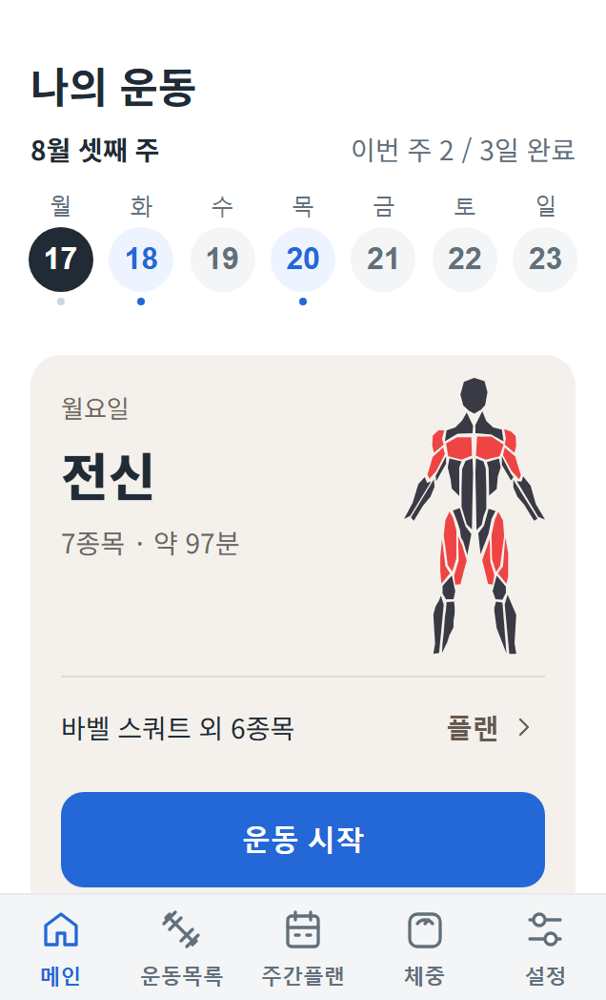
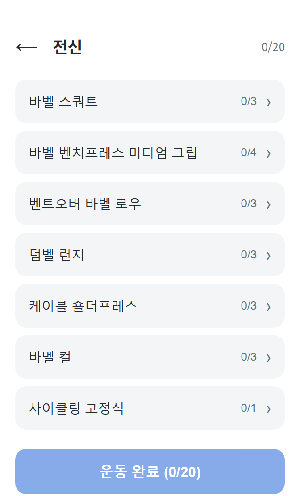
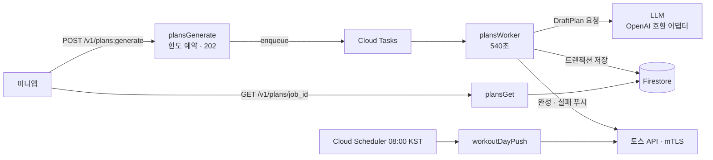
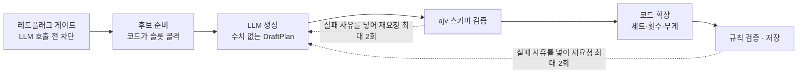

# 번위크 백엔드

> LLM이 짜 준 주간 운동 플랜을, 검증을 통과한 것만 사용자에게 보내는 토스 미니앱 백엔드

[](https://github.com/YoungkeunAhn/burnweek-backend/actions/workflows/ci.yml)


<p>
  
  
  
</p>

- **서비스**: 목표·주 운동 일수·장소를 고르면 LLM이 월~일 플랜을 만들고, 실행 기록이 다음 주 처방에 반영됩니다. 토스 앱 안의 미니앱 플랫폼(앱인토스)에 2026.09 정식 출시해 운영 중입니다.
- **이 저장소**: 운영 저장소의 `backend/`와 설계 문서를 그대로 옮긴 공개본입니다. 테스트는 이 저장소만으로 전부 돌아갑니다. 미니앱 프런트엔드, 진행 중 작업 메모, 배포 설정의 계정 정보는 싣지 않았습니다.
- **담당**: 기획, API 설계, 데이터 모델링, LLM 파이프라인, 배포, 운영

## 핵심 설계 세 가지

1. **접수와 생성을 큐로 분리** — LLM 응답이 수십 초에서 수 분까지 걸려서, 요청은 202로 받고 생성은 Cloud Tasks 워커가 합니다. 앱은 폴링하고, 끝나면 푸시를 받습니다. ([ADR-0011](docs/decisions/0011-async-plan-generation.md))
2. **LLM에는 선택만, 수치는 코드가** — LLM은 슬롯별 후보 중 종목만 고르고, 세트·횟수·무게는 코드가 계산합니다. 출력은 ajv 스키마와 운동 규칙으로 두 번 거르고, 떨어지면 실패 사유를 넣어 최대 2회 다시 요청합니다. ([ADR-0006](docs/decisions/0006-provider-agnostic-llm-adapter.md) · [ADR-0025](docs/decisions/0025-generation-pipeline-p1.md))
3. **실패해도 상태가 꼬이지 않게** — 생성 한도 예약·정산·환불을 Firestore 트랜잭션으로 묶고, 잡 상태 전이(`queued → running → ok|error`)로 중복 실행과 늦게 온 워커의 저장을 막습니다. 아래 표 참고.

## 구조



함수 6개(`authToss`, `tossWithdraw`, `plansGenerate`, `plansWorker`, `plansGet`, `workoutDayPush`)가 모두 서울 리전에 있습니다. Firestore 보안 규칙은 클라이언트 접근을 전부 막고, 함수의 Admin SDK로만 읽고 씁니다([`backend/firestore.rules`](backend/firestore.rules)).

### 생성 파이프라인



본체는 [`backend/src/generation/handler.ts`](backend/src/generation/handler.ts), 스키마는 [`backend/src/schemas/`](backend/src/schemas)에 있습니다.

## 비동기 처리의 실패 경로

| 상황 | 처리 | 코드 | 테스트 |
|---|---|---|---|
| 한도 예약 후 큐 등록 실패 | 잡이 아직 `queued`일 때만 트랜잭션으로 한도 환불 + `error` 기록. 복구마저 실패하면 예약 만료(20분) 뒤 다음 요청 때 환불 | [index.ts L509-L526](backend/src/index.ts#L509-L526) · [access.ts](backend/src/generation/access.ts) | `queue failures refund free and reward reservations without granting twice` |
| 같은 잡의 중복 실행 | 큐 재시도 1회 제한. 워커는 `queued → running` 전이 트랜잭션에 성공했을 때만 실행 | [index.ts L542](backend/src/index.ts#L542) · [L553-L561](backend/src/index.ts#L553-L561) | `stale jobs release the account and late workers cannot save or refund again` |
| 생성이 마감 시간을 넘김 | 플랫폼 종료 15초 전에 스스로 멈추고 실패 기록·환불·실패 푸시 | [index.ts L116-L146](backend/src/index.ts#L116-L146) | `ends an over-budget job as error + failure push instead of leaving it running` |
| 저장 후 푸시 실패 | 커밋 뒤에 푸시하므로 플랜은 남음. 앱은 폴링으로 결과 확인 | [index.ts](backend/src/index.ts) plansWorker | `real worker settles or refunds reservations (save-error)` |

테스트 이름은 모두 [`backend/test/generation-api-contract.test.ts`](backend/test/generation-api-contract.test.ts)에 있습니다.

## 기술적 의사결정

| 결정 | 검토한 대안 | 채택 | 근거 |
|---|---|---|---|
| 생성 요청 처리 | 동기 응답(p95 60초 목표) | 202 접수 + Cloud Tasks 워커 + 푸시·폴링 | POC에서 응답 31~68초, 앱이 백그라운드로 가면 요청이 끊김 · [ADR-0011](docs/decisions/0011-async-plan-generation.md) |
| 꼬리 지연 | 추론 끄기 (12종×3회 A/B에서 p90 182.7초 → 32.7초) | 추론 유지 + 워커 540초 + 자체 마감 | 추론을 끄면 하드 게이트 통과 32/36 → 17/36 · [ADR-0016](docs/decisions/0016-generation-timeout-and-compact-draft.md) |
| 플랜 수치 | LLM이 최종 플랜까지 생성 | 코드가 골격·수치, LLM은 선택 | 구조화 출력이 값 범위를 보장하지 못함 · [ADR-0025](docs/decisions/0025-generation-pipeline-p1.md) |
| 런타임 | Cloudflare Workers + Hono(조사 추천안) | Firebase Functions Gen2 | 콜드스타트(1~12초)를 감수하고 무료 쿼터 선택, Blaze 필수가 드러난 뒤에도 실청구 0원·이전 비용으로 유지 · [ADR-0008](docs/decisions/0008-backend-runtime-firebase.md) |
| 운동 미디어 | 앱 번들 / Firebase Storage | Cloudflare R2 + 해시 불변 URL | 번들 99,045,191 bytes로 100MB 한도 근접, 전송비 · [ADR-0026](docs/decisions/0026-exercise-media-on-r2.md) |

결정 기록 전체는 [`docs/decisions/`](docs/decisions)(ADR 30건 + [결정 로그](docs/decisions/mvp-decision-log.md))에 있습니다.

## 트러블슈팅

| 문제 | 원인 | 해결 |
|---|---|---|
| 실기기 토스 로그인이 전부 401 | 확인 스크립트는 PEM, 함수는 RC2-40 암호화 p12 → Node 22(OpenSSL 3)가 거부 | 변환 단계를 없애고 PEM 하나로 통일 |
| 헬스장 플랜 생성이 전부 실패 | 접수와 워커가 후보 목록을 각자 만들어, 새 방식(P1) 결과를 옛 허용 목록이 거부 | `prepareGeneration` 공유 + 회귀 테스트 17건 |
| TTL이 안 걸려 데이터가 계속 쌓임 | `expires_at`을 ISO 문자열로 저장 | Date 타입으로 수정, 삭제 경합 10건 함께 정리 |
| 프로덕션에서만 조회 API 500 | 내림차순 정렬에 복합 색인 필요 | 기본 색인 오름차순으로 읽고 뒤에서 자름 |

원인 분석과 재현 과정은 [`docs/troubleshooting.md`](docs/troubleshooting.md)에 정리했습니다.

## 실행과 테스트

```bash
cd backend
npm ci
npm test          # Vitest 885개 (실제 LLM을 부르는 4개는 키가 없으면 건너뜀)
npm run typecheck
```

테스트는 Firestore·토스 API·LLM을 모두 테스트 더블로 대체해, 키나 에뮬레이터 없이 돕니다. 로컬에서 실제 LLM으로 돌려 보려면 [`backend/.env.example`](backend/.env.example)을 `backend/.env.local`로 복사해 키를 넣습니다.

## 저장소 구성

```
backend/
  src/index.ts            함수 6개 (접수·워커·조회·로그인·탈퇴·예약 푸시)
  src/generation/         파이프라인, 한도 예약·정산, 규칙 검증
  src/llm/                OpenAI 호환 어댑터 (공급자 교체)
  src/schemas/            ajv JSON Schema 2020
  src/auth/               토스 mTLS 로그인, HMAC 세션, 계정 버전
  test/                   계약·골든셋·공급자 교체 회귀·mTLS 로컬 서버·LLM 심판 하네스
docs/decisions/           ADR 30건, 결정 로그
docs/architecture/        개요, 데이터 모델, LLM 어댑터
```

## 한계와 다음 과제

- CI는 이 공개본에 처음 붙였습니다. 운영 저장소는 git hook(커밋 전 타입 검사, 푸시 전 전체 테스트)으로 검사해 왔습니다.
- 플랫폼이 워커를 강제로 끝내면 잡이 `running`으로 남고, 20분 예약 만료 뒤에야 정리됩니다. 오래 멈춘 잡을 찾아 실패로 정리하는 작업이 필요합니다.
- 지연·실패율은 구조화 로그로만 봅니다. 모델별 p90·실패율 대시보드가 다음 과제입니다.
